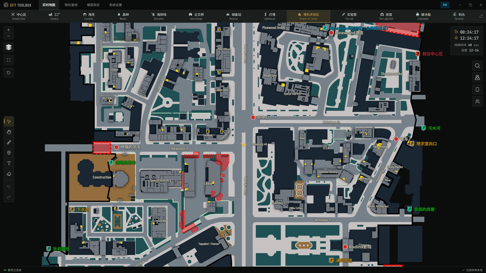

<h1 align="center">EFTToolbox</h1>

<a href="README.md">English</a> | 简体中文

  <b>地图、价格、队友，一屏搞定。</b> 
  面向逃离塔科夫的便携桌面工具箱，将互动地图、实时定位、图像查价、手机投屏与多人联机整合在一起，让玩家不必在游戏外反复查图、查价和报点。

    
    
    
    
    
    

  

## 🧰 功能

### 1. 互动地图

- 在高清地图上查看楼层、物资、任务、撤离点和自定义标记。
- 自由涂鸦、放置图钉、添加文字。
- 解析游戏截图与日志，自动识别当前地图、楼层与位置。
- 配备小地图，按需开启，悬浮在游戏画面上

### 2. 图像查价

- 联网获取最新物品价格。
- 一键截图，自动识别价格，并推送到悬浮窗。

### 3. 联机投屏

- 生成投屏二维码，手机扫码即可同步查看地图信息。
- 创建或加入房间，与队友共享位置和标记，共同规划路线。

### 4. 楼层标定

- 手动校准高度与楼层的对应关系，让位置更贴合实际画面。

## 🚀 快速开始

1. 从仓库的 Releases 页面下载最新版本压缩包。
2. 将压缩包解压到任意目录。
3. 双击目录中的 `EFTToolbox.exe` 启动程序。
4. 在 `系统设置 > 系统 > 游戏监测` 中配置截图与日志目录。截图目录通常为 `C:\Users\<用户名>\Documents\Escape from Tarkov\Screenshots`，日志目录通常为 `...\Escape from Tarkov\build\Logs`。
5. 在 `系统设置 > 快捷键` 中按个人习惯设置快捷键。
6. 享受游戏。

## 🛡️ 安全

- 仅使用游戏截图与日志。
- 不注入游戏进程，不访问游戏内存，不修改游戏文件。

## 🛣️ 路线图

- [ ] 为破冰船更新楼层标定。
- [ ] 为实验室、迷宫、破冰船补充抽象地图（当前仅有卫星地图）。
- [ ] 优化其他地图的标定准确度。

## 🙏 鸣谢

感谢 [Tarkov.dev](https://tarkov.dev/) 提供地图素材与资源数据，三方依赖见随包更新的 THIRD-PARTY-NOTICES 。

## 📜 许可证

Copyright 2026 ErtisT127

本项目采用 [Apache License 2.0](http://www.apache.org/licenses/LICENSE-2.0) 许可证，详见 [LICENSE](LICENSE) 文件。
